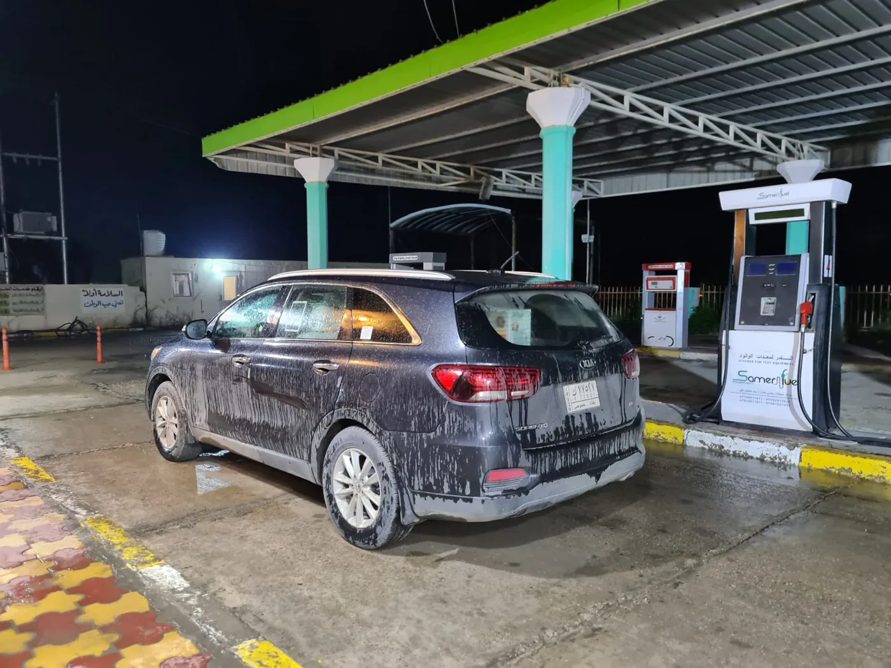

# Hemsida för bensinstationen – instruktioner

Hela hemsidan är **en enda fil: `index.html`**. Ingen databas, inget inloggningssystem, inga byggverktyg.
Öppna filen i en vanlig texteditor (t.ex. Notepad, TextEdit eller gratisprogrammet VS Code).

## 1. Byt ut exempeluppgifterna

Allt du ska ändra är markerat med `✏️ BYT UT` i koden. Använd "Sök och ersätt" (Ctrl+H) för det som förekommer på flera ställen:

| Vad | Exempelvärde i filen | Var |
|---|---|---|
| Stationens namn | `محطة الوفاء للوقود` | titel, meny, startsida, om oss, sidfot, Google-data |
| Stad | `بغداد` | startsida, adress, beskrivning |
| Telefon (synlig) | `+964 770 000 0000` | snabbinfo, kontakt, sidfot |
| Telefon (ringlänk) | `tel:+9647700000000` | samma ställen – utan mellanslag, med `+964` |
| Adress | `شارع المثال` / `حي المثال` | snabbinfo, kontakt, sidfot, Google-data |
| GPS-position | `33.3152,44.3661` | alla Google Maps-länkar + `latitude`/`longitude` |
| Öppettider | `٦:٠٠ ص …` | snabbinfo + tabellen "أوقات العمل" + Google-data |
| Vägbeskrivning | `بالقرب من دوار المثال…` | kontaktsektionen |
| Bränslen | 4 kort under `أنواع الوقود المتوفرة` | ta bort/lägg till `<article class="fuel">` |
| Övriga tjänster | 6 kort under `خدمات أخرى` | radera de ni inte har |
| Logotyp | gul ruta med droppe | se kommentar i headern |
| Webbadress | `https://www.example.com/` | `canonical`, Google-data, `robots.txt`, `sitemap.xml` |

**GPS-position:** Öppna Google Maps, högerklicka exakt på stationen, klicka på siffrorna som visas (t.ex. `33.31234, 44.36123`) så kopieras de. Klistra in dem i stället för `33.3152,44.3661` (utan mellanslag i länkarna).

**Google-data:** Blocket `<script type="application/ld+json">` högst upp hjälper Google att visa adress och öppettider. Uppdatera det med samma uppgifter.

## 2. Lägg in riktiga foton

Hemsidan använder en tecknad illustration så att den laddar direkt utan bildfiler. Egna foton av er station gör störst intryck:

1. Skapa mappen `images/` bredvid `index.html`.
2. Spara fotot som `hero.webp` eller `hero.jpg`, ca 1200 px brett och helst under 200 KB (komprimera gratis på squoosh.app).
3. Ersätt hela `<svg …>…</svg>` inuti `<div class="hero-art">` med:
   ```html
   
   ```

Logotyp: lägg `images/logo.svg` (eller `.png`) och ersätt `<span class="brand-mark">…</span>` med
``.

## 3. Språk: arabiska och engelska

- Arabisk version: `index.html` (adress `/`)
- Engelsk version: `en/index.html` (adress `/en`)
- Språkknappen sitter längst upp till höger i sidhuvudet på båda.

**Ändrar du uppgifter (telefon, adress, öppettider) – ändra i båda filerna.**

**Kurdiska senare:** kopiera `index.html` till `ku/index.html`, ändra första raden till `<html lang="ckb" dir="rtl">`, översätt texterna, och lägg till en språkknapp och en `hreflang="ckb"`-rad som för engelskan.

## Adminpanel (`/admin`)

Logga in på `din-adress/admin` med ditt Supabase-konto.

- **الأسعار / Priser** – pris i IQD per liter och om bränslet finns. Visas direkt på hemsidan.
- **النصوص / Texter** – rubriker, beskrivningar, adress, telefon, kartlänk och öppettider på arabiska och engelska.
- **الصور / Bilder** – huvudbild, logotyp och bildgalleri. Bilder komprimeras automatiskt.

Texterna i HTML-filerna är reservtext som visas om databasen inte går att nå.
Ny admin: skapa användaren i Supabase (Authentication → Users) och kör
`insert into public.admins (user_id) select id from auth.users where email = 'EPOST';`

## 4. Publicera på internet (gratis)

**Snabbast – Netlify Drop:**
1. Gå till app.netlify.com/drop och skapa ett gratis konto.
2. Dra hela mappen (med `index.html`, `robots.txt`, `sitemap.xml`, ev. `images/`) till sidan.
3. Klart – du får en adress som `namn.netlify.app`. Vill du ändra något: dra in mappen igen.

**Alternativ:** GitHub Pages eller Cloudflare Pages fungerar på samma sätt.

**Eget domännamn** (t.ex. `alwafaa-station.com`): köp det hos en domänleverantör och koppla det under "Domain settings" i Netlify. Uppdatera sedan `example.com` i filerna.

## 5. Synas på Google

1. **Google Business Profile** (business.google.com) – viktigast. Då syns stationen på Google Maps med öppettider, telefon och länk till hemsidan.
2. **Google Search Console** – lägg till din adress och skicka in `sitemap.xml`.
3. Använd samma namn, adress och telefon överallt (hemsida, Google, sociala medier).
